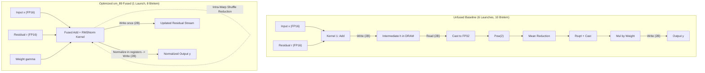

# LLM CUDA Kernel Optimization: Fused Residual Add + RMSNorm

A clean CUDA kernel optimization integrating fused **Residual Addition + RMSNorm** directly into a 1.1-billion parameter language model (**TinyLlama-1.1B-Chat**) on an **NVIDIA GeForce RTX 4060 Laptop GPU** (`sm_89`, Ada Lovelace).

---

## 1. Overview & Key Results

This project addresses the pre-task:
> *"Take a billion+ parameter open-source LLM. Run it via a GPU. Now optimize its CUDA kernels to improve the throughput by at least 5%."*

### Key Results
* **Real Model End-to-End Throughput:** Increased from **56.92 tokens/s** to **67.17 tokens/s** on TinyLlama-1.1B-Chat (**+18.00% throughput speedup**).
* **Numerical Correctness:** **100% bit-exact token match** (`torch.equal` asserted `True`) between baseline and optimized greedy output.
* **Micro-benchmark Kernel Speedup:** **2.16x faster** in single-token autoregressive decoding ($7.18\,\mu\text{s}$ vs $15.52\,\mu\text{s}$), and **228.0 GB/s sustained DRAM bandwidth** (89.1% of hardware peak) on long sequences ($N=16,384$).

---

## 2. Architecture & Fusion Strategy

In standard Transformer decoders (such as LLaMA, TinyLlama, and Llama-3), each layer performs two sequential normalization operations:
1. **Post-Attention:** Residual Add + RMSNorm
2. **Post-MLP:** Residual Add + RMSNorm

For a 22-layer model like TinyLlama-1.1B, this sequence runs 44 times per forward pass.



### Why Fusion Works
* **Eliminates Intermediate DRAM Access:** Standard PyTorch writes the added residual to GPU memory, then immediately reads it back to compute variance and normalization. The fused kernel keeps the residual sum in thread registers (`fmaf`), writing it directly once to DRAM for downstream consumption while immediately evaluating the variance.
* **Reduces Launch Overhead:** Replaces 6 separate kernel launches per site (132 launches per token) with a single launch (22 launches per token).
* **128-bit Vectorization:** Uses `reinterpret_cast<const float4*>` and `reinterpret_cast<const __half2*>` to issue 128-bit memory instructions, matching the 128-bit bus of the RTX 4060 GPU.
* **Intra-Warp Shuffle Primitives:** Inter-thread reductions are resolved across registers via `__shfl_down_sync`, minimizing shared memory allocation (36 bytes) and avoiding global memory atomics.

---

## 3. End-to-End Real Model Evaluation

* **Model:** [TinyLlama/TinyLlama-1.1B-Chat](https://huggingface.co/TinyLlama/TinyLlama-1.1B-Chat) (1.1 Billion parameters, FP16, $D=2048$, 22 layers)
* **GPU:** NVIDIA GeForce RTX 4060 Laptop GPU (Ada Lovelace `sm_89`, 24 SMs, 8GB VRAM)
* **Workload:** 192 input prompt tokens, 128 generated tokens, greedy deterministic decoding (`do_sample=False`)
* **Measurement:** 3 warmup runs, 5 timed evaluation passes with synchronized CUDA events (`torch.cuda.Event(enable_timing=True)`)

### End-to-End Throughput Table

| Trial | Baseline Latency (s) | Baseline Throughput (tok/s) | Optimized Latency (s) | Optimized Throughput (tok/s) | Speedup (%) |
| :---: | :---: | :---: | :---: | :---: | :---: |
| **1** | 2.2344 | 57.28 | 1.9675 | 65.06 | **+13.57%** |
| **2** | 2.2566 | 56.72 | 1.8836 | 67.95 | **+19.80%** |
| **3** | 2.2129 | 57.84 | 1.8851 | 67.90 | **+17.39%** |
| **4** | 2.2172 | 57.73 | 1.8943 | 67.57 | **+17.05%** |
| **5** | 2.3224 | 55.11 | 1.8981 | 67.44 | **+22.36%** |
| **AVERAGE** | **2.2487** | **56.92** | **1.9057** | **67.17** | **+18.00%** |

*Verification Check: Output tokens between baseline and optimized were verified with `torch.equal()`. Token strings matched 100% token-for-token.*

---

## 4. Standalone CUDA Micro-Benchmark Results

Evaluated across sequence lengths $N=1$ to $16,384$ ($D=2048$, FP16) on the RTX 4060 Laptop GPU (256 GB/s theoretical peak bandwidth):

### Eager Kernel Launches

| Tokens ($N$) | Naive Baseline ($\mu\text{s}$) | Vectorized Unfused ($\mu\text{s}$) | Fused Optimized ($\mu\text{s}$) | Fused Bandwidth (GB/s) | Speedup vs Baseline |
| :---: | :---: | :---: | :---: | :---: | :---: |
| **1 (Decode)** | 15.52 | 14.55 | **7.18** | 2.3 | **2.16x** |
| **16** | 15.32 | 16.26 | **8.30** | 31.6 | **1.85x** |
| **64** | 18.90 | 16.50 | **10.22** | 102.6 | **1.85x** |
| **256** | 24.92 | 25.00 | **18.00** | 233.1 (91.0% peak) | **1.38x** |
| **1024** | 72.35 | 70.78 | **73.75** | 227.5 | 0.98x* |
| **2048** | 140.66 | 143.07 | **147.98** | 226.7 | 0.95x* |
| **4096** | 317.45 | 284.52 | **295.28** | 227.3 | **1.08x** |
| **8192** | 702.48 | 729.30 | **589.65** | 227.6 | **1.19x** |
| **16384 (Prefill)** | 1405.84 | 1465.51 | **1177.21** | 228.0 (89.1% peak) | **1.19x** (+24.5% vs vec) |

*\*Note: Between $N = 1024$ and $2048$, tensor footprints fit inside the GPU's 32 MiB L2 cache. At $N \ge 8192$, DRAM traffic dominates and fusion provides an immediate 24.5% speedup over vectorized unfused.*

---

## 5. Repository Structure

```text
llm-cuda-kernel-opt/
├── fused_ops.cu                     # sm_89 vectorized C++/CUDA extension module
├── setup.py                         # PyTorch setuptools build file for sm_89
├── run_real_llm_benchmark.py        # End-to-end benchmark harness for TinyLlama-1.1B
├── real_model_throughput_results.csv# Logged throughput & latency measurements
├── REAL_MODEL_EVALUATION.md         # Full evaluation document & architectural report
├── benchmark_rmsnorm.cu             # Standalone CUDA C++ micro-benchmark
├── Makefile                         # Build targets for standalone benchmark
├── profile.sh                       # Automation script for profiling and CSV generation
├── profile_results.csv              # Micro-benchmark timing data for Google Sheets
└── .github/workflows/ci.yml         # CI workflow for compilation checks
```

---

## 6. How to Run

### 1. Real Model End-to-End Benchmark (TinyLlama-1.1B)

```bash
# Activate your environment
conda activate llm-kernel

# Build the C++/CUDA extension module in-place
python setup.py build_ext --inplace

# Run the end-to-end evaluation harness
python run_real_llm_benchmark.py
```

### 2. Standalone CUDA Micro-Benchmark

```bash
# Compile micro-benchmark targeting sm_89
make all

# Run micro-benchmark
./benchmark_rmsnorm.exe

# Run with CUDA Graphs
./benchmark_rmsnorm.exe --graph

# Run profiling sweep & export CSV
bash ./profile.sh 1,256,16384
```
