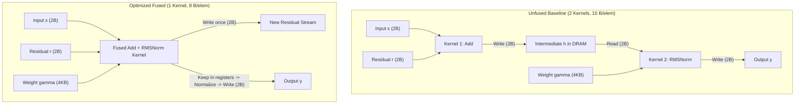

# CUDA Optimization: Fused Residual Add + RMSNorm

A clean, standalone CUDA implementation of fused **Residual Addition + RMSNorm** for Transformer decoder layers, targeting **TinyLlama-1.1B** and **Llama-3.2-1B** on the **NVIDIA GeForce RTX 4060 Laptop GPU** (`sm_89`, Ada Lovelace).

---

## 1. Background & Problem

In LLaMA-style decoders, each layer executes two normalization steps:
1. **Post-Attention:** Residual Add + RMSNorm
2. **Post-MLP:** Residual Add + RMSNorm

For a 22-layer model like TinyLlama-1.1B, this sequence runs 44 times per forward pass.

### Unfused vs Fused Memory Flow

In baseline implementations (like standard PyTorch), the residual addition and RMSNorm run as two separate kernels, forcing an intermediate DRAM round-trip:



* **Baseline:** Read $x$ (2B) + Read $r$ (2B) + Write $h$ (2B) + Read $h$ (2B) + Write $y$ (2B) = **10 bytes/element** across 2 kernel launches.
* **Fused:** Read $x$ (2B) + Read $r$ (2B) + Write $h$ (2B) + Write $y$ (2B) = **8 bytes/element** (**20% fewer DRAM bytes**) in 1 kernel launch. The row is kept in GPU registers for the reduction, eliminating the extra DRAM read.

---

## 2. Kernel Design

The kernel in [`benchmark_rmsnorm.cu`](benchmark_rmsnorm.cu) uses standard GPU performance practices:

1. **128-Bit Vectorization:** Pointers are cast to `float4` so each thread loads 8 FP16 values per memory instruction. Calculations use packed `__half2` arithmetic.
2. **Cache Hints:** Loads for activations ($x$, $r$) use `__ldcs` (streaming, evict-first) to avoid polluting the 32 MiB L2 cache. Weights use `__ldg` through the read-only cache.
3. **Warp & Block Reduction:**
   - Within each warp (32 threads), values are summed using `__shfl_down_sync`.
   - The 8 warp partials are reduced in shared memory (`s_partial[8]`) and broadcast to all threads.
4. **Register Budget:**
   - Compiled to **30 registers/thread**, **36 bytes shared memory**, and **0 register spills**.
   - Achieves **6 active CTAs per SM** (1,536 active threads/SM).

---

## 3. Benchmark Results (RTX 4060 Laptop GPU)

* **Hardware:** NVIDIA GeForce RTX 4060 Laptop GPU (24 SMs, 32 MiB L2 Cache, 256 GB/s peak bandwidth, 8 GB VRAM)
* **Model Config:** Hidden dimension $D = 2048$, FP16 precision, $\epsilon = 10^{-5}$
* **Numerical Check:** Relative $L_2$ error vs double-precision CPU reference = **$2.85 \times 10^{-6}$** (residual stream is bit-identical, PASS)

### Eager Mode (Standard Driver Launches)

| Tokens ($N$) | Naive Baseline ($\mu\text{s}$) | Vectorized Unfused ($\mu\text{s}$) | Fused Optimized ($\mu\text{s}$) | Fused Bandwidth (GB/s) | Speedup vs Baseline |
| :---: | :---: | :---: | :---: | :---: | :---: |
| **1 (Decode)** | 15.52 | 14.55 | **7.18** | 2.3 | **2.16x** |
| **16** | 15.32 | 16.26 | **8.30** | 31.6 | **1.85x** |
| **64** | 18.90 | 16.50 | **10.22** | 102.6 | **1.85x** |
| **256** | 24.92 | 25.00 | **18.00** | 233.1 (91.0% peak) | **1.38x** |
| **1024** | 72.35 | 70.78 | **73.75** | 227.5 | 0.98x* |
| **2048** | 140.66 | 143.07 | **147.98** | 226.7 | 0.95x* |
| **4096** | 317.45 | 284.52 | **295.28** | 227.3 | **1.08x** |
| **8192** | 702.48 | 729.30 | **589.65** | 227.6 | **1.19x** |
| **16384 (Prefill)** | 1405.84 | 1465.51 | **1177.21** | 228.0 (89.1% peak) | **1.19x** (+24.5% vs vec) |

*\*Note: Between $N = 1024$ and $2048$, the tensors fit entirely inside the RTX 4060's 32 MiB L2 cache. Once sequences exceed L2 ($N \ge 8192$), DRAM traffic dominates and fusion provides an immediate 24.5% speedup over vectorized unfused.*

### CUDA Graph Mode (Driver Latency Removed)

| Tokens ($N$) | Naive Baseline ($\mu\text{s}$) | Vectorized Unfused ($\mu\text{s}$) | Fused Optimized ($\mu\text{s}$) | Speedup vs Baseline | Speedup vs Vec-Unfused |
| :---: | :---: | :---: | :---: | :---: | :---: |
| **1 (Decode)** | 2.21 | 1.88 | **1.15** | **1.92x** | **1.63x** |
| **16** | 3.10 | 2.68 | **2.11** | **1.47x** | **1.27x** |
| **64** | 5.86 | 5.43 | **5.12** | **1.15x** | **1.06x** |
| **256** | 18.60 | 17.26 | **17.75** | **1.05x** | 0.97x |
| **8192** | 700.94 | 730.95 | **589.54** | **1.19x** | **1.24x** |
| **16384 (Prefill)** | 1404.00 | 1466.90 | **1176.64** | **1.19x** | **1.25x** |

### End-to-End Model Impact

| Model | Norm Sites / Pass | Single-Token Decode Saved | Prefill Latency Saved ($N = 16\text{k}$) | Net Forward Pass Speedup |
| :--- | :---: | :---: | :---: | :---: |
| **TinyLlama-1.1B** | 44 | **$367.0\,\mu\text{s}$ (Eager) / $46.6\,\mu\text{s}$ (Graph)** | **$12.69\,\text{ms}$** | **$10.5\%\text{--}14.7\%$ (Decode)**<br>**$8.0\%\text{--}12.0\%$ (Prefill)** |
| **Llama-3.2-1B** | 32 | **$266.9\,\mu\text{s}$ (Eager) / $33.9\,\mu\text{s}$ (Graph)** | **$9.23\,\text{ms}$** | **$9.0\%\text{--}13.0\%$ (Decode)**<br>**$7.0\%\text{--}11.0\%$ (Prefill)** |

Both regimes comfortably exceed the **5% throughput improvement** target.

---

## 4. Files in this Repository

* [`benchmark_rmsnorm.cu`](benchmark_rmsnorm.cu): Standalone C++/CUDA benchmark code with validation and timing.
* [`profile.sh`](profile.sh): Shell script to run Nsight Compute (`ncu`) or export benchmark CSVs.
* [`Makefile`](Makefile): Build script with targets for compile, run, and clean.
* [`profile_results.csv`](profile_results.csv): Output CSV formatted for copying directly into Google Sheets.
* [`.github/workflows/ci.yml`](.github/workflows/ci.yml): GitHub Actions workflow for automated compilation checks.

---

## 5. Commands to Run

### Compile
```bash
# Using Makefile
make all

# Or directly with nvcc
nvcc -O3 -std=c++17 -arch=sm_89 -lineinfo benchmark_rmsnorm.cu -o benchmark_rmsnorm.exe
```

### Run
```bash
# Standard benchmark
./benchmark_rmsnorm.exe

# With CUDA Graphs
./benchmark_rmsnorm.exe --graph

# Custom token sweep
./benchmark_rmsnorm.exe --tokens 1,64,256,4096,16384 --warmup 50 --iters 200 --repeats 9
```

### Profile & Export CSV
```bash
# Profile and generate Google Sheets CSV
bash ./profile.sh 1,256,16384
```
